<div align="center">

# Islands of Insight Puzzle Finder

**Find nearby puzzles and track what's left, right on the world map and in your HUD.**

An addon for **Islands of Insight** (Windows) with the
[Offline Restored Mod v1.6](https://github.com/RiccTheThicc/RRMod_PuzzleFix/releases/tag/v1.6).

[](https://github.com/ardelato/ioi-puzzle-finder/releases)
[](https://github.com/ardelato/ioi-puzzle-finder/actions/workflows/tests.yml)
[](LICENSE)

[**Download**](https://github.com/ardelato/ioi-puzzle-finder/releases) ·
[Install](#install) ·
[Controls](#the-compass) ·
[Report a bug](https://github.com/ardelato/ioi-puzzle-finder/issues/new?template=bug_report.md)

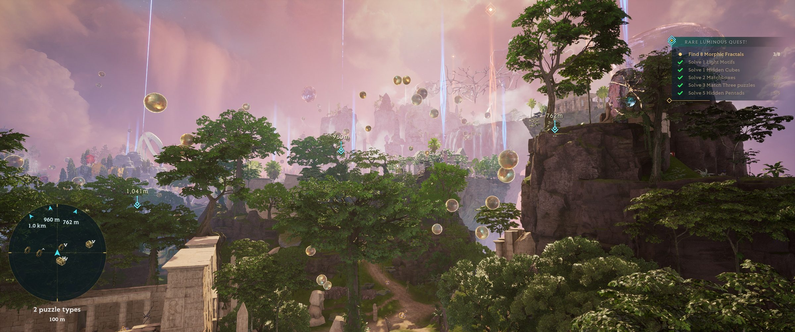

<sub>Hidden Cubes and Rings nearby, and three of your own map markers on the rim with their distances.</sub>

</div>

## Why I built this

Finishing Islands of Insight meant hunting down whatever I'd missed, and the
only way to see that was [SaveStats](https://github.com/RiccTheThicc/RRMod_PuzzleFix/tree/main/SaveStats_src),
the community tool that reads your save and draws your unsolved puzzles on a
map image. So my evenings went like this: run the script, open the image, line
it up with the in-game map, then wander around trying to find the spot.

Puzzle Finder puts that map **inside the game**. It adds puzzle filters to the
world map and a compass to your HUD, and reads your progress live: solve a
puzzle and its pin is gone. From there it grew into the parts of the game
that frustrated me most, **Hidden Pentads** and **Crystal Labyrinths**, and
more helpers are on the way.

## Features

- 🗺️ **Puzzle filters on the map.** A **Puzzles** tab in the map legend lists
  every puzzle type in the zone you're looking at, with how many you've solved.
  Tick any number of types to pin them on the map; hover a pin to see what it is.
- 📡 **A compass in your HUD.** Close the map and the ticked types follow you,
  each with its own icon. **^** and **v** mark puzzles above or below you.
- ✅ **Solved means gone.** Pins disappear as soon as the game counts a puzzle
  as solved. Rotating puzzles only show while the game has them out.
- 🎲 **Random-spot puzzles too.** Some rotating puzzles, like Logic Grids, land
  on a different spot each time. Switch on **Show random-spot puzzles** and
  they're pinned where one actually is right now.
- ⭐ **Hidden Pentad helper.** Start a Pentad and the compass shows just its
  remaining relics.
- 🔷 **Crystal Labyrinth floors.** Inside a labyrinth, the compass draws the floor
  you're on.
- 🧭 **Your own map markers** always show on the compass, with the distance to
  far-away ones.
- ⌨️ **Your keys, your settings.** Rebind the compass keys, and everything you
  pick is remembered next time you play.

### On the map

<div align="center">
  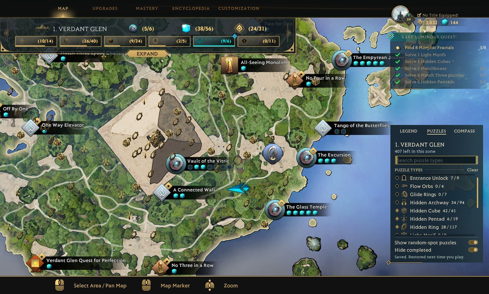
</div>

### Random-spot puzzles

<div align="center">
  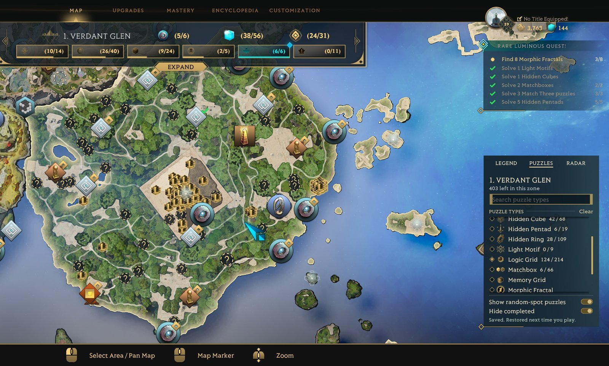
  <br>
  <sub>Logic Grid ticked with <b>Show random-spot puzzles</b> on. Gold pins are Logic Grids that always sit in the same place; each <b>?</b> is one the game has put on a random spot right now.</sub>
</div>

### On the compass

<div align="center">

| Ticked puzzle types | Your map markers |
| :---: | :---: |
| 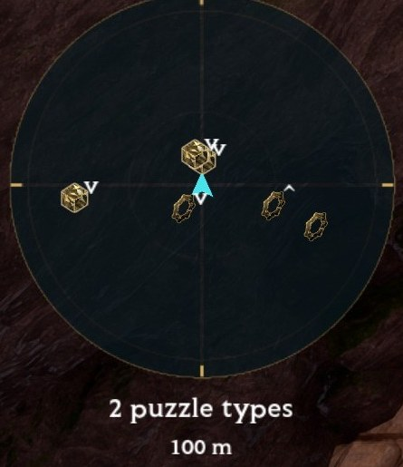 | 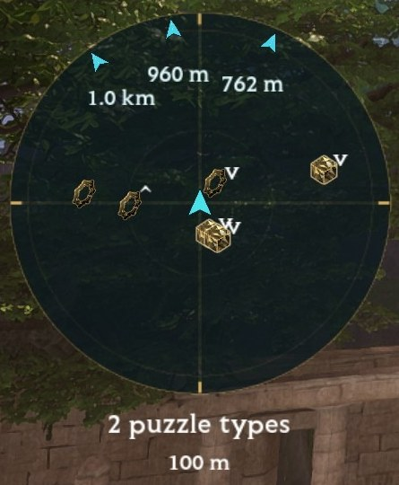 |

</div>

### Crystal Labyrinths

<div align="center">
  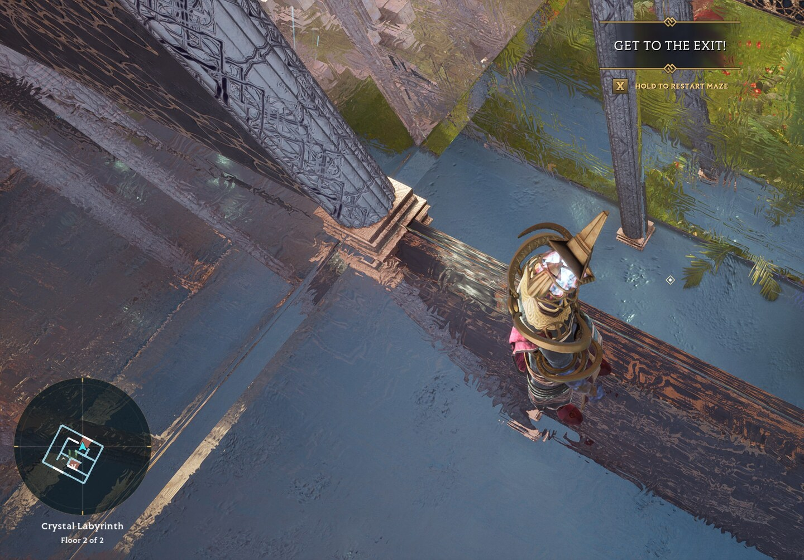
  <br>
  <sub>Floor 2 of 3. The reddish cells on the compass are trap doors: holes in the floor you'd fall through.</sub>
</div>

Inside a Crystal Labyrinth the compass switches to a floor plan of the level you
are on and zooms to fit it:

| Mark | Meaning |
| --- | --- |
| White lines | Solid walls |
| Light-blue lines | Glass walls |
| Reddish squares | Trap doors: holes in the floor you can fall through |
| **^** / **v** | A way to the floor above or below (in the Vault of the Vitric, a jump pad and the shaft above it) |

*Floor N of M* appears under the ring, also in labyrinths you've already
solved. Hub labyrinths and the seven in the Vault of the Vitric are drawn; the
other handmade labyrinths aren't yet.

### Hidden Pentad

<div align="center">

| Before you start | Started: five relics | Two found: three left |
| :---: | :---: | :---: |
| 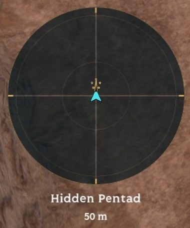 | 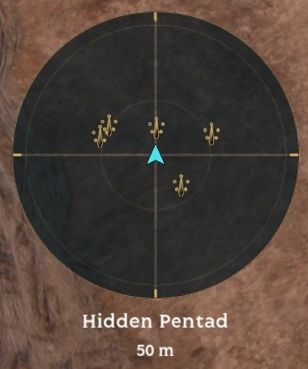 | 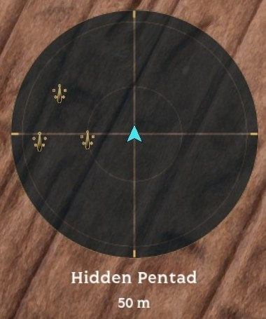 |

</div>

## Install

**You need:** Islands of Insight on Windows with the **full**
[Offline Restored Mod v1.6](https://github.com/RiccTheThicc/RRMod_PuzzleFix/releases/tag/v1.6)
installed, including its runtime components. Nothing else: no PHP, SaveStats or
build tools.

1. Download the latest `ioi-puzzle-finder-<version>.zip` from
   [**Releases**](https://github.com/ardelato/ioi-puzzle-finder/releases).
2. Close the game. In Steam, right-click **Islands of Insight** and choose
   **Manage → Browse local files**.
3. Extract the ZIP to a temporary folder and copy **only** the `.pak` file into:

   ```text
   IslandsofInsight/Content/Paks/
   ```

   Keep its filename. The `ZZ_` prefix makes it load after the base mod.
4. Start the game, open the map, then open the **Puzzles** tab in the map legend
   (lower right) and tick one or more puzzle types.

**Updating:** close the game and copy the new `.pak` over the old one. Coming from 0.1.0, when this addon was called Puzzle Radar? Delete `ZZ_IOIPuzzleRadar_P.pak` from `Paks` too, or both copies load. Your settings start fresh; you can delete the old `IOIPuzzleRadar.sav` from `Saved\SaveGames`.

**Uninstalling:** close the game and remove the Puzzle Finder `.pak` from `Paks`.
The base mod and your save are left untouched.

> [!IMPORTANT]
> Only download Puzzle Finder from this repository's
> [Releases](https://github.com/ardelato/ioi-puzzle-finder/releases) page. A copy
> from anywhere else may have been changed. Each release also lists a SHA-256
> checksum, for anyone who wants to confirm the file is exactly what was published.

## Using it

### The map panel

The map legend in the lower right has three tabs: **Legend** (the game's own),
**Puzzles** and **Compass**. The map ignores the cursor while it's over the panel.

**Puzzles** follows the zone selected on the map:

- The header shows the zone and how many puzzles are left there.
- The list shows the puzzle types found in that zone, sorted by name, with
  *solved / total* for each, or *done* when nothing is left. Counts fill in
  over a few seconds after opening the map or changing zone.
- Type in the search box to narrow the list; **Clear** unticks everything.
- **Hide completed** removes finished types from the list. Ticked types stay so
  you can untick them.
- **Show random-spot puzzles** also pins rotating puzzles that the game puts on
  a random spot each time, such as Logic Grids. A pin appears only where a
  puzzle of a ticked type is out right now, starting a few seconds after you
  switch it on. On the map these pins are a dashed circle marked **?**.

**Compass** holds **Show puzzle compass**, the range (50 to 400 m) and size
choices, and the compass keys.

<div align="center">

| The Puzzles tab | The Compass tab |
| :---: | :---: |
| 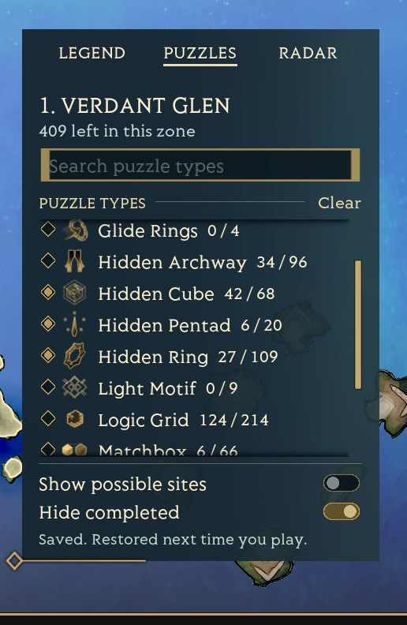 | 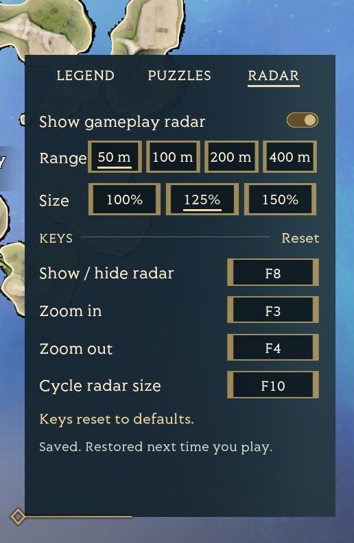 |

</div>

### The compass

| Default key | Action |
| :---: | --- |
| <kbd>F8</kbd> | Show or hide the compass |
| <kbd>F3</kbd> | Zoom in |
| <kbd>F4</kbd> | Zoom out |
| <kbd>F10</kbd> | Cycle the display size |

**To change a key**, open the map's **Compass** tab, click the key next to the
action and press the new one. **Esc** cancels; mouse buttons and Shift, Ctrl,
Alt or Cmd on their own aren't accepted. Choosing a key another compass action
already uses swaps the two, and **Reset** restores the defaults. The compass
doesn't check the game's own bindings, so avoid keys you use to play.

- The number under the compass is its **range**, not the distance to a puzzle.
- **^** / **v** mark puzzles more than 10 metres above or below you.
- Your custom map markers always appear: in range at their position, farther
  away as a cyan arrow on the rim with their distance.
- The compass hides during menus and puzzle input, and comes back afterwards.

### Saved settings

Your ticked types, **Hide completed**, **Show random-spot puzzles**, the compass
switch, range, size and keys
are saved as you change them and restored the next time you play. They live in
`IOIPuzzleFinder.sav` in the game's `Saved\SaveGames` folder, apart from your
progress save. Delete that file to start over with the defaults.

## Questions

<details>
<summary>Does it change my save?</summary>

No. Puzzle Finder only reads your progress so it can hide solved puzzles. Its
own settings go in a separate `IOIPuzzleFinder.sav`. Removing the `.pak` puts
the game back exactly as it was.

</details>

<details>
<summary>Why don't I see every rotating (Hub) puzzle?</summary>

Many puzzles rotate: the game brings them out for a while, then swaps them for
others. Rotating puzzles that always appear in the same place get a pin, but
only while the game has them out.

Others, like Logic Grids, are placed on a random spot each time. Switch on
**Show random-spot puzzles** in the Puzzles tab to pin those too. The addon
looks up where the game put them as you play, so their pins take a few seconds
to appear and empty spots stay hidden.

</details>

<details>
<summary>The Puzzles tab doesn't appear</summary>

Check that the `.pak` is directly in `IslandsofInsight/Content/Paks/` (not in a
subfolder), that its filename still starts with `ZZ_`, and that the full Offline
Restored Mod v1.6 is installed.

</details>

<details>
<summary>The game won't start after installing</summary>

Close the game and remove the Puzzle Finder `.pak` from `Paks`. Make sure only
one Puzzle Finder package was installed and that the base mod is complete, then
[open an issue](https://github.com/ardelato/ioi-puzzle-finder/issues/new?template=bug_report.md)
saying whether removing the addon fixed it.

</details>

## Compatibility

- Built and tested against the **Offline Restored Mod v1.6**. Other base-mod
  versions are untested.
- Other mods that replace the world map or the gameplay HUD can conflict.
- At most 24 nearby points are drawn on the compass at once; very dense areas may
  take a few updates to settle.

## Reporting a bug

[Open an issue](https://github.com/ardelato/ioi-puzzle-finder/issues/new?template=bug_report.md)
with the addon version, the ticked puzzle types, where you were and the steps
to reproduce. A screenshot helps for anything visual. Please remove account
IDs and personal paths from logs, and don't attach save files.

## For developers

The addon is generated rather than hand-made. Islands of Insight runs on Unreal
Engine 4.27, and modders don't have the game's editor project, so a PHP and
PowerShell pipeline does the editor's job:

1. **Extract** the world map, HUD and puzzle database from the installed mod
   with UnrealPak, and decode them to JSON with UAssetGUI.
2. **Catalog** every puzzle location by combining SaveStats' data with the
   game's puzzle database.
3. **Generate** the map panel and compass as new Blueprint classes, writing their
   logic directly as Kismet bytecode, plus map markers and icon textures.
4. **Verify** by re-encoding everything, decoding it again and checking it
   matches what was generated, with the game's own functions left unchanged.
5. **Pack** a `.pak` that asks the game's own progression system what's solved
   and what's out, live.

- [docs/BUILDING.md](docs/BUILDING.md): building from your own game install.
  The synthetic test suite runs without any game files: `.\scripts\test.ps1`.
- [docs/RELEASING.md](docs/RELEASING.md): how releases are packaged and published.
- [CONTRIBUTING.md](CONTRIBUTING.md): issues and pull requests.

## Credits and license

Thanks to Rushin, [RiccTheThicc](https://github.com/RiccTheThicc), meltdown and
the Islands of Insight community for the
[Offline Restored Mod](https://github.com/RiccTheThicc/RRMod_PuzzleFix) and
[SaveStats](https://github.com/RiccTheThicc/RRMod_PuzzleFix/tree/main/SaveStats_src),
which this addon builds on.

The source code is [MIT licensed](LICENSE). Game assets keep their owners'
rights; see [NOTICE](NOTICE) and the
[third-party notices](THIRD_PARTY_NOTICES.md) for credits and asset provenance.

*Not affiliated with or endorsed by the game's developer or publisher.*
