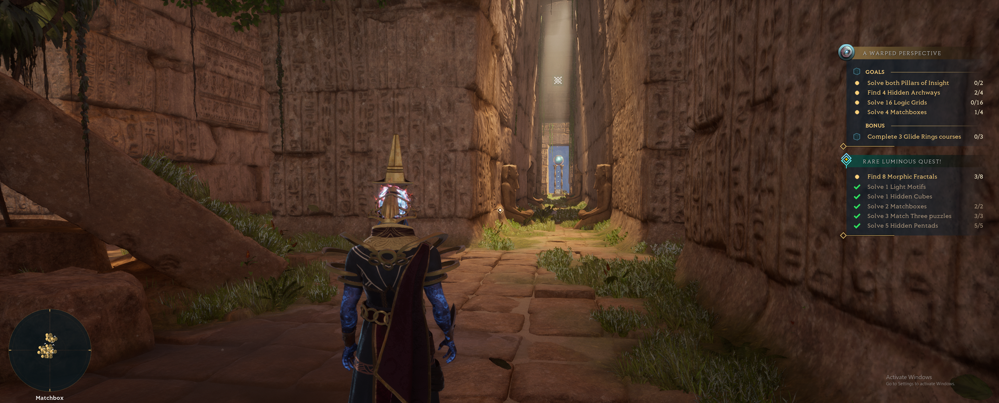

# Islands of Insight Puzzle Radar

Find nearby puzzles and track what’s left on the world map while you play.
Puzzle Radar is an addon for **Islands of Insight** on Windows with the full
**Offline Restored Mod v1.6** installed.

[Download the beta](https://github.com/ardelato/ioi-puzzle-radar/releases/tag/v0.1.0-beta.1) · [Build from source](docs/BUILDING.md) · [Beta test checklist](docs/BETA-TESTING.md) · [Contribute](CONTRIBUTING.md)

*Early gameplay capture showing Matchboxes on the radar in the lower-left corner.*

| In the world map | While exploring |
| --- | --- |
| Pick one puzzle type in **Puzzle filters**. Hover a pin to see its name and ID. | Leave **Show radar** checked and close the map to see nearby puzzles of that type. |
| Solved puzzles disappear as you play. Hub pins follow the current fixed puzzle selection. | Activate a Hidden Pentad to focus the radar on its remaining relics. |

## Install

1. Install the full [Offline Restored Mod v1.6](https://github.com/RiccTheThicc/RRMod_PuzzleFix/releases/tag/v1.6), including its runtime components.
2. Close the game. In Steam, open **Islands of Insight → Manage → Browse local files**.
3. Extract the release ZIP. Move any previous Puzzle Radar package outside `IslandsofInsight/Content/Paks/` and copy the single `.pak` from the ZIP into that folder.
4. Start the game, open the map, and select a type under **Puzzle filters** in the lower-left corner.

The published `0.1.0-beta.1` archive contains `ZZ_SaveStatsMap_P.pak`.
Builds from this source tree produce `ZZ_IOIPuzzleRadar_P.pak`.
Keep only one of these files in `Paks`. To uninstall, close the game and
remove your Puzzle Radar package from that folder.

## Radar controls

| Key | Action |
| --- | --- |
| **F8** | Show or hide the radar |
| **F3** | Zoom in |
| **F4** | Zoom out |
| **F10** | Cycle the display size |

The distance under the radar is its radius. Up and down carets mark puzzles
more than 10 metres above or below you. Radar settings last for the current
session. The radar hides during menus and puzzle input.

**Include possible spawn sites** shows places where the selected type can spawn.
Treat these cyan pins as search areas. Fixed puzzle pins follow live progress
and clear when the game records a solve.

## Compatibility and feedback

The release ZIP includes everything needed for the addon once the full base
mod is installed. Other mods that replace the world map or gameplay HUD can
conflict. For beta reports, include the package version, selected puzzle type,
and steps to reproduce. [Open an issue](https://github.com/ardelato/ioi-puzzle-radar/issues) · [Testing checklist](docs/BETA-TESTING.md)

Thanks to Rushin, RiccTheThicc, meltdown, and the Islands of Insight community
for the Offline Restored Mod and SaveStats. See the
[third-party notices](THIRD_PARTY_NOTICES.md) for credits and asset provenance.
